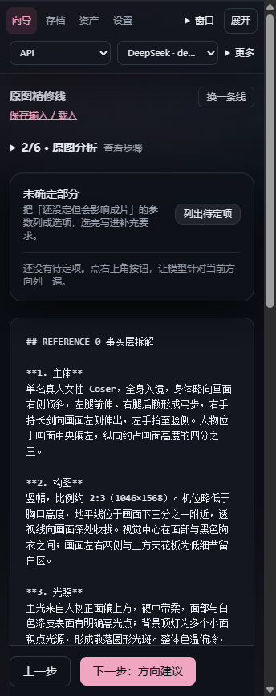
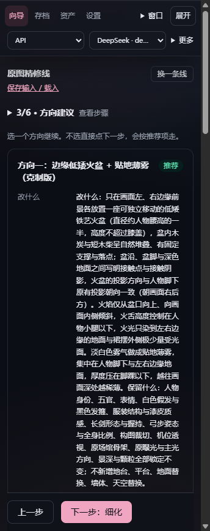
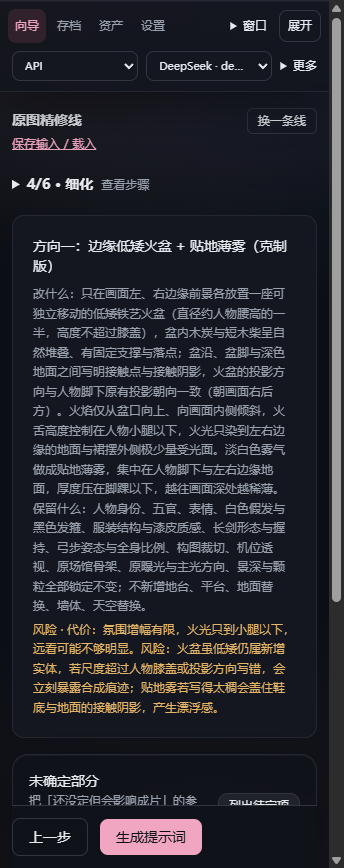
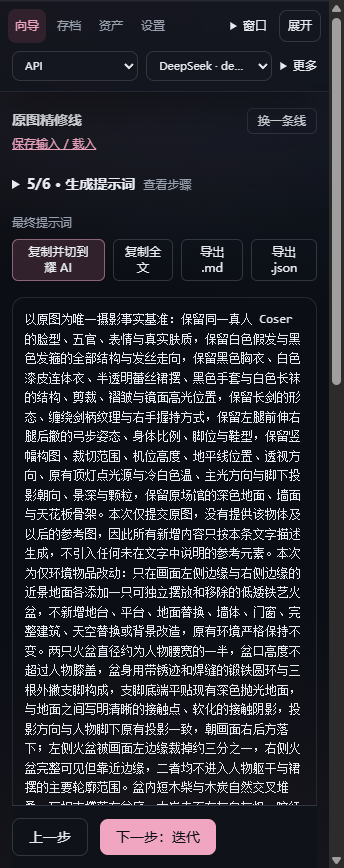
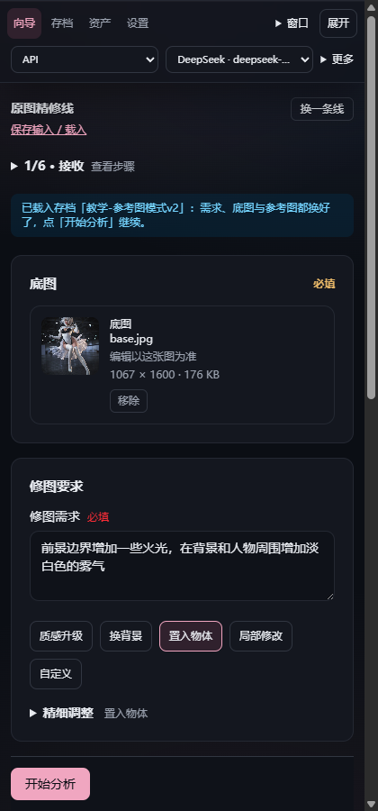
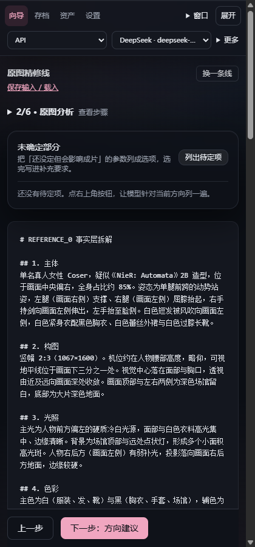
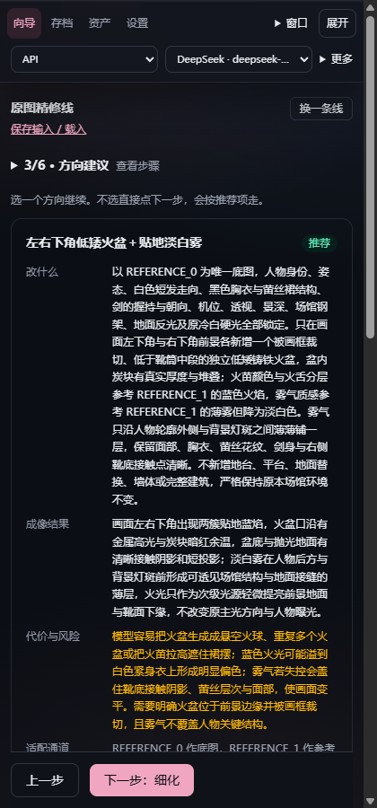
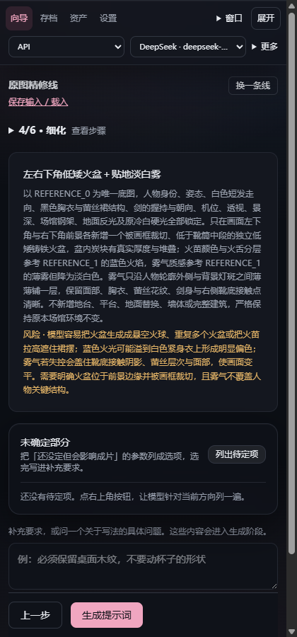
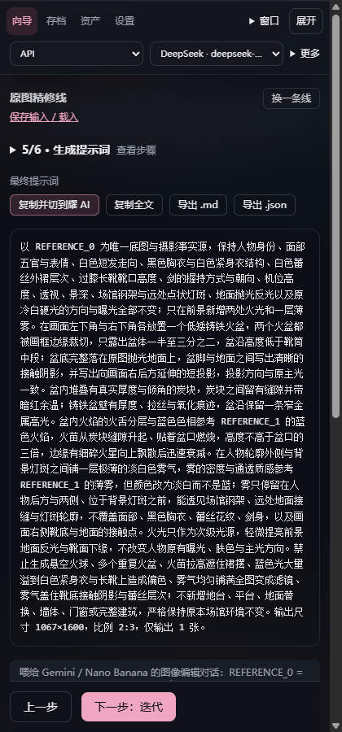

# 原图精修流 · API 模式全流程教学

> 用一张真实 Cosplay 场照，从「接收」走到「生成提示词」，两种写法各跑一遍：
> **A. 置入物体（不引用参考图）** 与 **B. 参考图模式（点名引用 REFERENCE_1）**。
> 目标产物都是**中文提示词**，需求统一为：**前景边界增加火光，背景与人物周围增加淡白色雾气**。

- 通道：**API · DeepSeek · deepseek-flash**
- 底图：`images/base.jpg`（原图 5544×8313，导入时自动压到 1067×1600 / 176 KB）
- 参考图（仅 B 轮）：`images/ref.jpg`（1600×1066）
- 提示词语言：中文 · 交付形式：1 条完整提示词

---

## 一、先看两张成品

| A 轮（置入物体） | B 轮（参考图模式） |
|---|---|
| 973 字，纯文字描述火光与雾 | 738 字，点名 `REFERENCE_1` 借色相与雾质感 |

A 轮关键句：

> 本次为仅环境物品改动：只在画面左侧边缘与右侧边缘的近景地面各添加一只可独立摆放和移除的低矮铁艺火盆，不新增地台、平台、地面替换……火焰只从盆口向上并向画面内侧微微倾斜，**火舌高度控制在人物小腿以下**……**淡白色雾气做成贴地薄雾**，厚度压在脚踝以下。

B 轮关键句：

> 盆内火焰的火舌分层与蓝色色相**参考 REFERENCE_1 的蓝色火焰**……在人物轮廓外侧与背景灯斑之间铺一层极薄的淡白色雾气，雾的密度与通透质感**参考 REFERENCE_1 的薄雾，但颜色改为淡白而不是蓝**。

注意 B 轮做的事：**借鉴了参考图的"质感"，但否掉了它的颜色**。这是参考图模式的正确用法——参考图提供手法，不覆盖你的需求。

---

## 二、A 轮：置入物体（不引用参考图）

### 步骤 1 · 接收阶段填四件事

1. **底图**：点「选择底图」选 `base.jpg`。界面会显示压缩结果（176 KB → 142 KB），这是正常的：体积大的手机/相机原图会先压一版再送模型。
2. **修图需求**：`前景边界增加一些火光，在背景和人物周围增加淡白色的雾气`
   —— 只写"要什么"，**不要写"怎么做"**。怎么落地是模型在细化阶段的事。
3. **任务类型**：点模板「置入物体」。这一步很关键，它决定了后面要不要出现「置景模式 / 所在层次 / 水平位置 / 远近 / 交互关系」这些字段。
4. **约束**：把「保持不变」的项点一遍（或点「全选」）。我这次点了人物身份、发色、服装、动作、构图、机位、曝光、景深。

> 提示：约束区现在有**全选**，一次把所有锁定项写进约束框，重复点不会重复插入。

### 步骤 2 · 原图分析

点「开始分析」。模型做的是**事实层拆解**（主体 / 构图 / 光照 / 色彩 / 镜头 / 材质 / 接触关系 / 层级 / 禁区），不是给建议。

产出示例（节选）：

> **主体**：一名真人女性 Coser，单人，白色短发（疑似假发）……黑色胸衣配白色亮面连体衣、白色蕾丝裙摆……
> **光照**：主光来自人物左前上方，硬光，色温偏冷（约 5500–6000K）……投影落在人物脚下偏右后方，边缘较硬。

### 步骤 3 · 方向建议

模型给 6 个差异化方向，每个都写清**改什么 / 保留什么 / 风险·代价**。我这一轮选了「边缘低矮火盆 + 贴地薄雾（克制版）」。

选方向的判断依据是**风险**那一行：比如"火盆是低矮后续新增实体，若尺度超过人物膝盖会立刻暴露合成痕迹"。

### 步骤 4 · 细化

细化阶段会把方向落成可执行参数：盆的直径、盆口高度、支脚接触点、投影方向、火舌高度上限。

这一阶段还能用「列出待定项」让模型把没定死的参数列成选项（本例模型主动问了"地面替换与仅环境物品模式冲突，以哪条为准"）。

### 步骤 5 · 生成提示词

产出 973 字中文提示词，完整正文见 `flow1-prompt.txt`。

---

## 三、B 轮：参考图模式（点名引用）

这一轮唯一不同的是：**多一张参考图**，且把「提示词写法」改成**参考图参与（点名引用）**。

### 要改的三处

1. **参考图**：添加 `ref.jpg`，并在下面那格写**借用什么**：
   `借鉴火光颜色与雾气的质感`
   —— 这一格是参考图模式的核心。不写清楚借什么，模型会把它当第二张底图。
2. **提示词写法**：展开「精细调整」→ 找到「提示词写法」→ 选 **参考图参与（点名引用）**。
   选「置景合成（消隐参考图）」的话，模型会把参考图来源洗掉，就白传了。
3. 其余（底图、需求、任务类型、约束）与 A 轮一致。

### 分析阶段

注意 B 轮的分析里会出现对 `REFERENCE_1` 的独立描述——因为参考图真的进了请求。

### 方向与细化

### 结果

738 字，正文见 `flow2-prompt.txt`。与 A 轮最大的区别：

- 火光色相**点名参考 REFERENCE_1**
- 雾的通透质感**点名参考 REFERENCE_1**
- 但颜色仍按需求写成淡白 —— 模型自己做了"只借质感不借颜色"的判断

---

## 四、两轮对比：什么时候用哪个

| | A · 置入物体 | B · 参考图模式 |
|---|---|---|
| 需要几张图 | 1 张（底图） | 2 张（底图 + 参考图） |
| 参考图的作用 | 无 | 提供手法/色相/质感/结构 |
| 提示词写法 | 纯文字描述，不出现"参考图"字样 | 点名 `REFERENCE_1` 引用 |
| 适合 | 你脑内已有明确画面，只要模型照做 | 你手上有一张"就要这种感觉"的图 |
| 风险 | 新增物体容易穿帮（悬空、比例错、投影不对） | 模型可能把参考图的色调/构图也一起抄过来 |

**判断口诀**：能说清就用 A；说不清、只能"给我这种感觉"就用 B，并在备注里写清**只借什么、不借什么**。

---

## 五、几个容易踩的点

1. **需求只写目标，不写实施手段**。"前景加火光"是目标；"放两个铁盆、盆高 30cm"是实施，交给细化阶段。
2. **约束别偷懒**。不勾「保持不变」，模型会顺手"优化"人物脸部或发色。
3. **参考图备注必须写**。空着等于让模型自由发挥。
4. **选「参考图参与」而不是「消隐」**。选错等于白传参考图。
5. **文件太大先压**。应用会自动压，但 12 MB 的原图导入会很慢；先用 1600px 长边更顺手。

---

## 六、复现所需的文件

| 文件 | 说明 |
|---|---|
| `images/base.jpg` | 底图（1067×1600） |
| `images/ref.jpg` | 参考图（1600×1066） |
| `flow1-prompt.txt` | A 轮完整提示词（973 字） |
| `flow2-prompt.txt` | B 轮完整提示词（738 字） |
| `images/flow1-*.png` | A 轮各阶段截图 |
| `images/flow2-*.png` | B 轮各阶段截图（窄版） |
